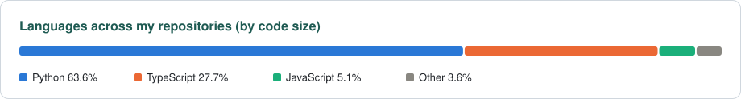

# Hi, I'm Dhvani 👋

  
  
  
  

I'm a data scientist who likes working close to the product. I take a messy question about how people use technology, find out what the data can really say about it, and then build the tool or analysis that helps a team act on the answer. My work so far is about half research and half engineering.

- 🔭 **Now:** Product Data Scientist at [SimPPL](https://simppl.org/team), building research-driven products on social data
- 🎓 **Studied:** BTech in Information Technology, DJSCE Mumbai (2022–26)
- 📄 **Research:** 5 papers published or accepted, with Springer, IEEE Xplore, CRC Press and the DPE Forum
- 🗣️ **Presented to:** Google, Stanford Trust & Safety, Bluesky and Boston University; my work has been piloted with CNN and featured by Nieman Lab
- 🤝 **Open to:** research collaborations and conversations with people building startups
- 🌐 **More about me:** [dhvani-shah.vercel.app](https://dhvani-shah.vercel.app)

---

### ✨ Featured projects

<table>
  <tr>
    <td width="50%" valign="top">
      <h4><a href="https://github.com/dhvani1403/TrialSafe">🩺 TrialMatch</a></h4>
      
An AI clinical-trial matcher. It reads ClinicalTrials.gov eligibility fine print, checks every rule against a patient's profile, ranks open studies near them and explains each match in plain language.

      
📈 Tested on 75 real patient cases (TREC 2021): NDCG@10 rose from 0.42 to 0.53 once the ranker learned from expert labels

      

        
        
        
        
      

    </td>
    <td width="50%" valign="top">
      <h4><a href="https://github.com/dhvani1403/clinical-fairness-audit">⚖️ Hidden Unfairness in Clinical Risk Models</a></h4>
      
Replicates <i>fairness gerrymandering</i> (Kearns et al., 2018) and audits who clinical risk scores miss. It covers 30-day readmission and high healthcare use, and is packaged as an audit tool for quality teams.

      
📈 Among adults with 3+ chronic conditions, the model flags 70% of White patients but only 56% of Hispanic patients

      

        
        
        
        
      

    </td>
  </tr>
</table>

---

### 🚀 Products and other work

| | What it is | Where it went |
|---|---|---|
| **Arbiter API** | The API behind SimPPL's social-data platform. It turns raw posts into structured insight using LLMs, retrieval and sentiment analytics. | Piloted with CNN and public-sector teams in New York and Maryland; featured in Nieman Lab |
| **InfluenceCheck** | Sponsorship detection and claim verification for beauty and skincare influencers, across 100 creators and 75+ products | Demoed to MeitY at the India AI Impact Summit and to ASCI |
| **Ychance** | Ratings for prediction markets on vagueness, manipulation risk and insider-trading risk, with AWS ingestion and LLM scoring | I lead it end to end, from research to pilot interviews |
| **Iffy News domain scores** | Quality scores for news sites from website metadata and AI, for a client project I led | ~10,000 domains scored |
| **Agricultural data lake** (Omdena) | ETL from USDA, FAOSTAT, Eurostat, IBGE and APS India into one Parquet lake, plus satellite crop features | 5+ global sources |
| **It Depends Where They Live** | A survey report on how children aged 8 to 15 in Delhi, Lucknow and Surat use social media | 900+ respondents |

---

### 📄 Research

1. **Can User Controls Benefit Value Creation on Platforms?** **Shah, D.**, Mehta, S. · *DPE Forum, Germany* · accepted A matched causal study of 10,712 Bluesky users. Presented to Google, Bluesky, Stanford Trust &amp; Safety and Boston University.
2. **An Intelligent Framework for Non-Parametric Test Prediction and Execution Using Machine Learning** **Shah, D.**, Chandaria, D., Shah, H., Patel, J. · *Springer*, Vol. 1748, Issue 21 (2026)
3. **Multilingual Phishing Analysis: Feature-Based Scoring and Level Classification** Shah, H., Sanghvi, D., **Shah, D.**, Patel, J., Sawant, V., Satam, P. · *IEEE Xplore*, Issue 23 (2026)
4. **Stock Market Prediction Using News API and Deep Learning Algorithms** Shah, H., **Shah, D.**, Parekh, D., Patel, J., Sharma, R. · *CRC Press*, Vol. 1 (2026)
5. **AQI Insight** **Shah, D.**, Shah, H., Parekh, D., Patel, J. · accepted for publication

---

### 🛠️ Tools I use

  

  
  
  
  
  
  

  <picture>
    <source media="(prefers-color-scheme: dark)" srcset="https://raw.githubusercontent.com/dhvani1403/dhvani1403/output/languages-dark.svg" />
    
  </picture>

